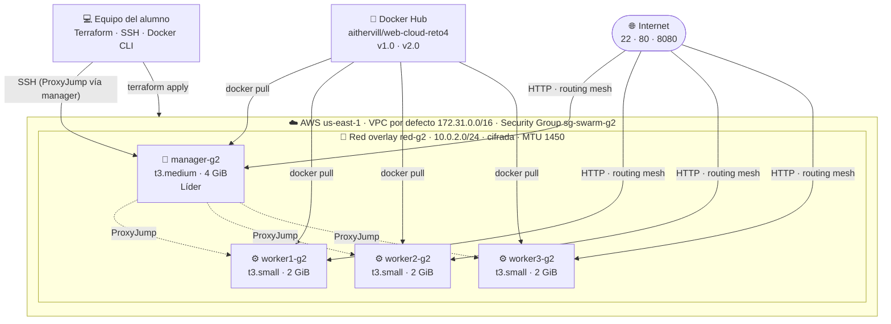

# 🐳 Web en clúster Docker Swarm con Terraform sobre AWS

**ASIR · Cloud · Reto 4 — Grupo 2 (g2)**

---

## 📑 Índice

- [Resumen del proyecto](#-resumen-del-proyecto)
- [Descripción general](#-descripción-general)
- [Pruebas de orquestación](#-pruebas-de-orquestación)
- [Enlaces](#-enlaces)
- [Equipo](#-equipo)

---

## 📌 Resumen del proyecto

El objetivo es **publicar en la nube la web del evento de Fórmula 1**, garantizando que soporte picos de tráfico y ofrezca alta disponibilidad. Para ello se despliega un **clúster Docker Swarm de cuatro nodos** sobre AWS (Learner Lab), creado íntegramente como **infraestructura como código con Terraform** y administrado por **SSH** con las claves públicas de cada integrante.

Con este proyecto se ha conseguido:

- ✅ Crear y gestionar infraestructura como código en AWS con Terraform.
- ✅ Administrar 4 servidores por SSH con claves públicas propias de cada integrante.
- ✅ Configurar un clúster Docker Swarm sobre una **red overlay personalizada** (MTU 1450).
- ✅ Desplegar la web con **4 réplicas** a partir de imágenes publicadas en Docker Hub (`v1.0` y `v2.0`).
- ✅ Demostrar balanceo de carga, escalado, autorreparación, alta disponibilidad, mantenimiento, actualización con *rollback* y elección de nuevo líder.

---

## 🧭 Descripción general

### Arquitectura

### Infraestructura

| Hostname | Rol | Recursos | Acceso |
|---|---|---|---|
| `manager-g2` | Manager (líder) | t3.medium · 2 vCPU · 4 GiB · disco 20 GB gp3 | SSH (clave alumno) |
| `worker1-g2` | Worker | t3.small · 2 vCPU · 2 GiB · disco 10 GB gp3 | SSH (clave alumno) |
| `worker2-g2` | Worker | t3.small · 2 vCPU · 2 GiB · disco 10 GB gp3 | SSH (clave alumno) |
| `worker3-g2` | Worker | t3.small · 2 vCPU · 2 GiB · disco 10 GB gp3 | SSH (clave alumno) |

- **Sistema:** Ubuntu 22.04 con Docker instalado en todos los nodos.
- **Región y red:** `us-east-1`, VPC por defecto (`172.31.0.0/16`).
- **Servicio:** `mi-aplicacion-web`, conectado a la red overlay `red-g2`.
- **Terraform:** el número de grupo, los tamaños de instancia y la imagen son variables; los tres workers se crean con un único recurso multiplicado con `count`.

### 🔒 Seguridad

Un único Security Group (`sg-swarm-g2`) protege los cuatro nodos:

| Origen | Puertos | Uso |
|---|---|---|
| Internet | `22/tcp` (solo IP autorizadas) | SSH |
| Internet | `80/tcp`, `8080/tcp` | Web |
| Solo entre nodos del mismo SG | `2377/tcp`, `7946/tcp+udp`, `4789/udp`, ICMP | Comunicación del clúster Swarm |

El clúster se construye con las **IP privadas**, porque las públicas cambian en cada sesión del laboratorio. Los workers se alcanzan por SSH mediante salto (`ProxyJump`) a través del manager.

---

## 🧪 Pruebas de orquestación

Todas las pruebas se hicieron con un script (`peticionWeb.sh`) que consulta con `curl` la web de los cuatro nodos en bucle y muestra el código HTTP, para detectar cualquier corte del servicio.

| Prueba | Comando clave | Resultado |
|---|---|---|
| **Balanceo y escala** | `docker service scale mi-aplicacion-web=8` y después `=2` | Sin caídas en ningún nodo |
| **Autorreparación** | `docker rm -f <contenedor>` en worker1 | Swarm crea una réplica nueva automáticamente |
| **Alta disponibilidad** | `sudo systemctl stop docker` en worker2 | Las 6 réplicas se reubican en los 3 nodos restantes |
| **Redistribución** | `docker service update --force mi-aplicacion-web` | Las réplicas vuelven a repartirse entre los 4 nodos |
| **Mantenimiento** | `docker node update --availability drain worker1-g2` y después `active` | Las réplicas se reubican y el servicio no se corta |
| **Actualización y rollback** | `docker service update --image ...:v1.0` y `docker service rollback` | Sustitución progresiva de réplicas sin caída |
| **Elección de líder** | `docker node promote worker1-g2 worker2-g2` y parar Docker en el manager | `worker1-g2` pasa a ser el nuevo *Leader* |

---

## 🔗 Enlaces

- 🐳 **Imagen en Docker Hub:** [`aithervill/web-cloud-reto4`](https://hub.docker.com/r/aithervill/web-cloud-reto4) (etiquetas `v1.0` y `v2.0`)

---

## 👥 Equipo

**Grupo 2 (g2)** — Garikoitz, Antonio, Aitor, Serrato y Endika.

*ASIR · Cloud · Reto 4 — Noviembre de 2026*
