**ASIR · CLOUD · RETO 4**

**Web en clúster Docker Swarm creado con Terraform sobre AWS**

Informe técnico del proyecto · Grupo 2 (g2)

**Integrantes**

**Garikoitz, Antonio, Aitor, Serrato y Endika**

**Imagen en Docker Hub**

aithervill/web-cloud-reto4 (etiquetas v1.0 y v2.0)

Noviembre de 2026

# Índice

[Índice [2](#índice)](#índice)

[1. Introducción y objetivos [2](#introducción-y-objetivos)](#introducción-y-objetivos)

[2. Arquitectura del proyecto [3](#arquitectura-del-proyecto)](#arquitectura-del-proyecto)

[2.1. Servidores [4](#servidores)](#servidores)

[3. Fase 1: Infraestructura con Terraform [4](#fase-1-infraestructura-con-terraform)](#fase-1-infraestructura-con-terraform)

[3.1. Código Terraform [4](#código-terraform)](#código-terraform)

[3.2. Creación de las máquinas EC2 [4](#creación-de-las-máquinas-ec2)](#creación-de-las-máquinas-ec2)

[3.3. Salidas (outputs) [5](#salidas-outputs)](#salidas-outputs)

[4. Fase 2: Acceso remoto por SSH [7](#fase-2-acceso-remoto-por-ssh)](#fase-2-acceso-remoto-por-ssh)

[4.1. Restricciones de seguridad [10](#restricciones-de-seguridad)](#restricciones-de-seguridad)

[5. Fase 3: Clúster Docker Swarm [10](#fase-3-clúster-docker-swarm)](#fase-3-clúster-docker-swarm)

[5.1. Inicialización del Swarm [10](#inicialización-del-swarm)](#inicialización-del-swarm)

[5.2. Unión de los workers [11](#unión-de-los-workers)](#unión-de-los-workers)

[5.3. Validación de los nodos [11](#validación-de-los-nodos)](#validación-de-los-nodos)

[5.4. Red overlay personalizada [11](#red-overlay-personalizada)](#red-overlay-personalizada)

[6. Fase 4: Despliegue de la web [12](#fase-4-despliegue-de-la-web)](#fase-4-despliegue-de-la-web)

[6.1. Preparación de la imagen [12](#preparación-de-la-imagen)](#preparación-de-la-imagen)

[6.2. Imagen versión 1.0 [12](#imagen-versión-1.0)](#imagen-versión-1.0)

[6.3. Despliegue del servicio [13](#despliegue-del-servicio)](#despliegue-del-servicio)

[6.4. Validación desde las IP públicas [13](#validación-desde-las-ip-públicas)](#validación-desde-las-ip-públicas)

[6.5. Imagen versión 2.0 [14](#imagen-versión-2.0)](#imagen-versión-2.0)

[6.6. Actualización del servicio a v2.0 [16](#actualización-del-servicio-a-v2.0)](#actualización-del-servicio-a-v2.0)

[7. Fase 5: Pruebas de orquestación [17](#fase-5-pruebas-de-orquestación)](#fase-5-pruebas-de-orquestación)

[7.1. Herramientas de prueba [17](#herramientas-de-prueba)](#herramientas-de-prueba)

[7.2. Balanceo y escala [17](#balanceo-y-escala)](#balanceo-y-escala)

[7.3. Autorreparación [18](#autorreparación)](#autorreparación)

[7.4. Alta disponibilidad [20](#alta-disponibilidad)](#alta-disponibilidad)

[7.5. Mantenimiento (drain) [23](#mantenimiento-drain)](#mantenimiento-drain)

[7.6. Actualización y rollback [24](#actualización-y-rollback)](#actualización-y-rollback)

[7.7. Managers [27](#managers)](#managers)

# 1. Introducción y objetivos

El objetivo del proyecto es publicar en la nube la web desarrollada para el evento de Fórmula 1, garantizando que soporte picos de tráfico y ofrezca alta disponibilidad. Para ello se ha desplegado un clúster Docker Swarm de cuatro nodos sobre AWS (Learner Lab), creado íntegramente como infraestructura como código con Terraform y administrado por SSH desde una consola remota.

Al finalizar el proyecto, el grupo ha conseguido:

- Crear y gestionar infraestructura como código en AWS usando Terraform.

- Administrar 4 servidores mediante SSH con claves públicas propias de cada integrante.

- Configurar un clúster Docker Swarm sobre una red overlay personalizada con MTU 1450.

- Desplegar la web con 4 réplicas a partir de imágenes publicadas en Docker Hub (v1.0 y v2.0).

- Demostrar balanceo de carga, escalado, autorreparación, alta disponibilidad, mantenimiento, actualización con rollback y elección de nuevo líder.

# 2. Arquitectura del proyecto

Todo el despliegue se realiza en la región us-east-1 (AWS Academy Learner Lab) sobre la VPC por defecto (172.31.0.0/16). Un único Security Group (sg-swarm-g2) protege los cuatro nodos: desde Internet solo se permite 22/tcp (SSH desde las IP autorizadas) y 80/tcp y 8080/tcp (web); los puertos del clúster (2377/tcp, 7946/tcp y udp, 4789/udp e ICMP) únicamente se abren entre los nodos del mismo grupo de seguridad.

El clúster se construye con las IP privadas, ya que las IP públicas cambian en cada sesión del laboratorio. Los workers son accesibles por SSH mediante salto (ProxyJump) a través del manager.

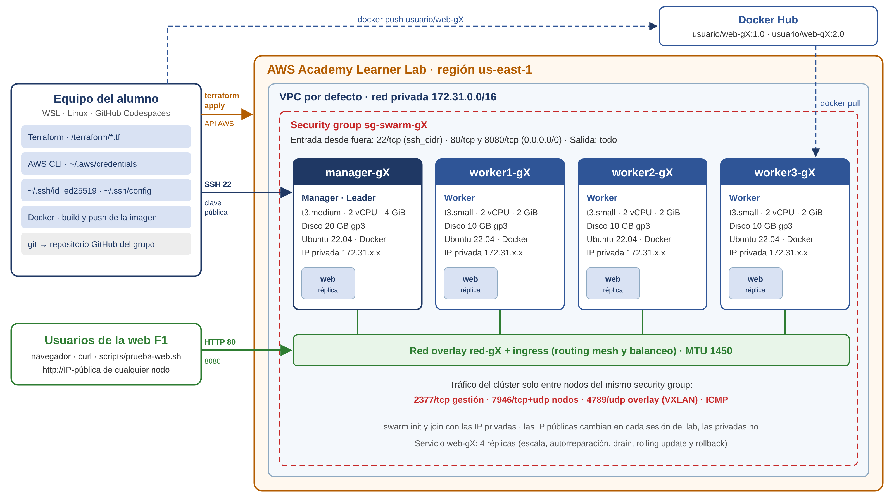

**Figura 1. Diagrama de arquitectura del clúster.** *Prueba: representar la arquitectura completa del proyecto. Resultado: se muestran el equipo del alumno, Docker Hub, los cuatro nodos de AWS, el security group y la red overlay red-g2. Autor: Aitor Hernández Asir.*

## 2.1. Servidores

| **Hostname** | **Rol en el clúster** | **Recursos**                                 | **Acceso**         |
|--------------|-----------------------|----------------------------------------------|--------------------|
| manager-g2   | Manager (líder)       | t3.medium · 2 vCPU · 4 GiB · disco 20 GB gp3 | SSH (clave alumno) |
| worker1-g2   | Worker                | t3.small · 2 vCPU · 2 GiB · disco 10 GB gp3  | SSH (clave alumno) |
| worker2-g2   | Worker                | t3.small · 2 vCPU · 2 GiB · disco 10 GB gp3  | SSH (clave alumno) |
| worker3-g2   | Worker                | t3.small · 2 vCPU · 2 GiB · disco 10 GB gp3  | SSH (clave alumno) |

Todos los nodos usan Ubuntu 22.04 con Docker instalado. La web se despliega como el servicio «mi-aplicacion-web» conectado a la red overlay «red-g2».

# 3. Fase 1: Infraestructura con Terraform

La infraestructura se define con Terraform a partir de la práctica individual de EC2 Ubuntu 22.04, ampliada a cuatro nodos. El número de grupo, los tamaños de instancia y la imagen son variables, y los tres workers se crean multiplicando un único recurso (count) en lugar de copiar el código.

## 3.1. Código Terraform

**\[PENDIENTE: incluir/capturar los ficheros .tf (variables, instancias, security group, outputs), el script de arranque (hostname, zona horaria Europe/Madrid, claves públicas e instalación de Docker) y la captura del listado de archivos de /terraform\]**

## 3.2. Creación de las máquinas EC2

Tras ejecutar terraform apply se crean las cuatro instancias (manager y tres workers). El security group se recrea en el mismo proceso.

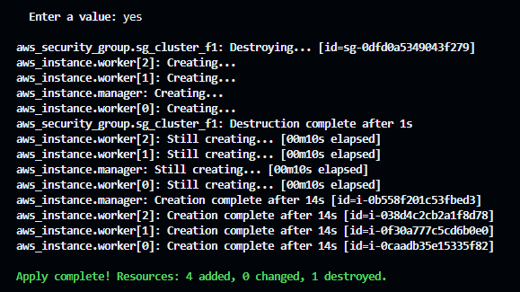

**Figura 2. Resultado de terraform apply.** *Prueba: creación de las instancias EC2 del clúster. Resultado: «Apply complete! Resources: 4 added, 0 changed, 1 destroyed», con las cuatro instancias creadas en 14 s. Autor: Aitor Hernández Asir.*

## 3.3. Salidas (outputs)

Terraform muestra el ID, la IP privada y la IP pública de cada nodo, necesarios para configurar SSH y Docker Swarm.

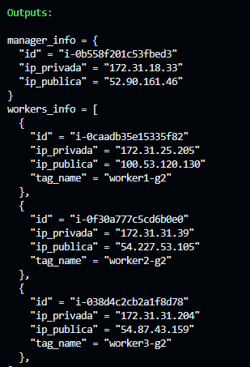

**Figura 3. Outputs mostrados al finalizar el apply.** *Prueba: mostrar ID, IP pública e IP privada de cada nodo. Resultado: manager con IP privada 172.31.18.33 y pública 52.90.161.46; workers 1 a 3 con sus respectivas direcciones. Autor: Aitor Hernández Asir.*

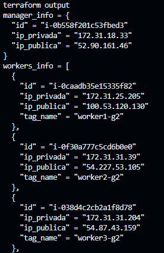

**Figura 4. Salida del comando terraform output.** *Prueba: consultar de nuevo las salidas de la infraestructura. Resultado: se recuperan los mismos datos de los cuatro nodos. Autor: Aitor Hernández Asir.*

# 4. Fase 2: Acceso remoto por SSH

Cada integrante genera su propio par de claves SSH y guarda las privadas en ~/.ssh/keys. Las claves públicas de todos los integrantes se añaden al fichero authorized_keys de cada máquina EC2 (mediante el script de arranque de Terraform). La clave vockey queda como acceso de reserva.

Para entrar usando solo el nombre corto se crea el fichero ~/.ssh/config. El manager se alcanza directamente y los workers mediante ProxyJump a través del manager, probando de forma secuencial las cinco claves de los integrantes.

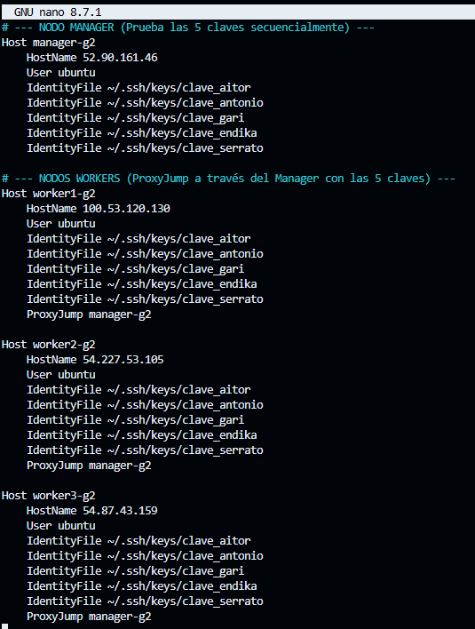

**Figura 5. Fichero ~/.ssh/config.** *Prueba: definir los hosts manager-g2, worker1-g2, worker2-g2 y worker3-g2. Resultado: cada worker incluye «ProxyJump manager-g2» y las cinco claves de los integrantes. Autor: Aitor Hernández Asir.*

Se accede por SSH a cada máquina. En caso de error extraño, conviene usar el parámetro -v para ver cada paso de la conexión.

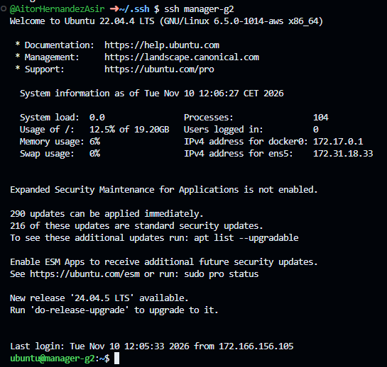

**Figura 6. Acceso SSH al manager.** *Prueba: entrar con «ssh manager-g2». Resultado: sesión abierta como ubuntu@manager-g2 (Ubuntu 22.04.4 LTS, IP privada 172.31.18.33). Autor: Aitor Hernández Asir.*

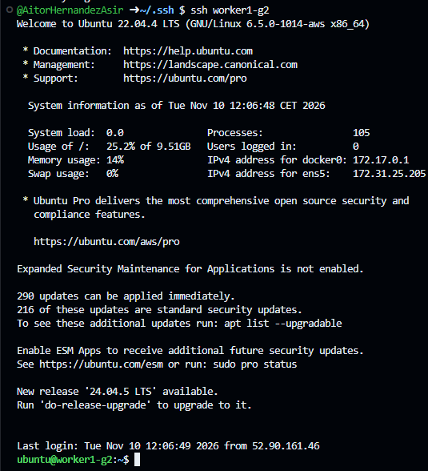

**Figura 7. Acceso SSH a worker1 mediante salto.** *Prueba: entrar con «ssh worker1-g2», saltando por el manager. Resultado: sesión abierta como ubuntu@worker1-g2 (IP privada 172.31.25.205); el último acceso consta desde la IP del manager (52.90.161.46). Autor: Aitor Hernández Asir.*

## 4.1. Restricciones de seguridad

**\[PENDIENTE: captura/configuración de sshd que demuestre root y acceso por contraseña deshabilitados (PermitRootLogin no, PasswordAuthentication no)\]**

**\[PENDIENTE: captura del acceso a un worker por IP privada usando el manager como salto\]**

# 5. Fase 3: Clúster Docker Swarm

## 5.1. Inicialización del Swarm

Swarm se inicia en el manager usando su IP privada (nunca la pública) con docker swarm init --advertise-addr 172.31.18.33.

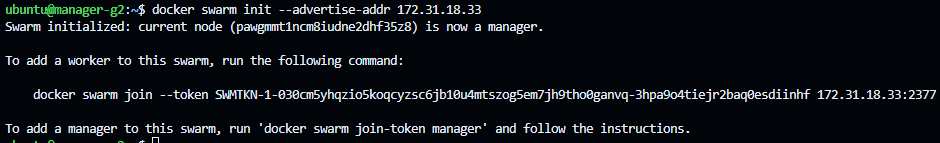

**Figura 8. Inicialización del clúster en el manager.** *Prueba: ejecutar docker swarm init con la IP privada. Resultado: el nodo manager-g2 pasa a ser manager y se genera el token de unión para workers. Autor: Aitor Hernández Asir.*

## 5.2. Unión de los workers

En cada worker se ejecuta el comando docker swarm join con el token obtenido y la IP privada del manager (puerto 2377). El proceso se repite en los tres workers.

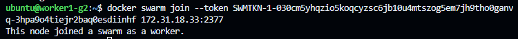

**Figura 9. Unión de worker1 al clúster.** *Prueba: ejecutar docker swarm join en worker1-g2. Resultado: «This node joined a swarm as a worker». Autor: Aitor Hernández Asir.*

## 5.3. Validación de los nodos

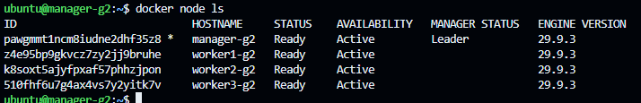

**Figura 10. Listado de nodos del clúster.** *Prueba: comprobar el estado con docker node ls. Resultado: los 4 nodos aparecen en estado Ready/Active y manager-g2 figura como Leader. Autor: Aitor Hernández Asir.*

## 5.4. Red overlay personalizada

Se crea la red overlay red-g2 con subred 10.0.2.0/24, cifrado activado y MTU 1450. Las redes subyacentes tienen una MTU estándar de 1500 bytes y Docker Swarm añade 50 bytes de encapsulación VXLAN; con MTU 1450 se evita la fragmentación de paquetes, que podría provocar cuelgues o lentitud en la web.

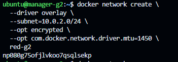

**Figura 11. Creación de la red red-g2.** *Prueba: crear la red overlay con --opt com.docker.network.driver.mtu=1450. Resultado: la red se crea y devuelve su identificador. Autor: Aitor Hernández Asir.*

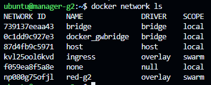

**Figura 12. Listado de redes de Docker.** *Prueba: comprobar que la red existe con docker network ls. Resultado: «red-g2» aparece con driver overlay y ámbito swarm, junto a la red ingress. Autor: Aitor Hernández Asir.*

# 6. Fase 4: Despliegue de la web

## 6.1. Preparación de la imagen

Se crea una carpeta con la página web (html/index.html) y el Dockerfile. La imagen se basa en nginx, copia el contenido de la carpeta html al directorio por defecto del servidor y expone el puerto 80.

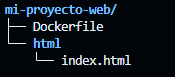

**Figura 13. Estructura del proyecto web.** *Prueba: mostrar los ficheros del proyecto. Resultado: carpeta mi-proyecto-web con Dockerfile y html/index.html. Autor: Aitor Hernández Asir.*

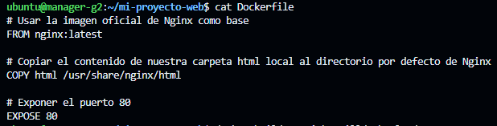

**Figura 14. Contenido del Dockerfile.** *Prueba: mostrar el Dockerfile de la imagen. Resultado: FROM nginx:latest, COPY html /usr/share/nginx/html y EXPOSE 80. Autor: Aitor Hernández Asir.*

## 6.2. Imagen versión 1.0

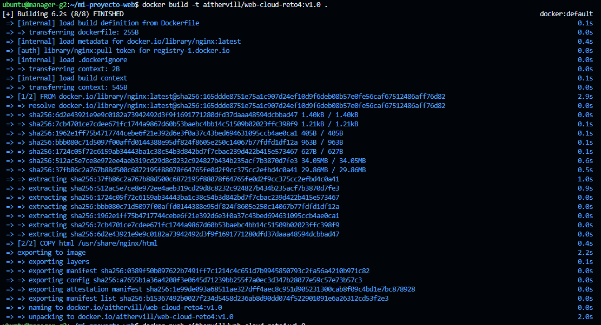

**Figura 15. Construcción de la imagen v1.0.** *Prueba: ejecutar docker build -t aithervill/web-cloud-reto4:v1.0. Resultado: la compilación finaliza correctamente (8/8 pasos). Autor: Aitor Hernández Asir.*

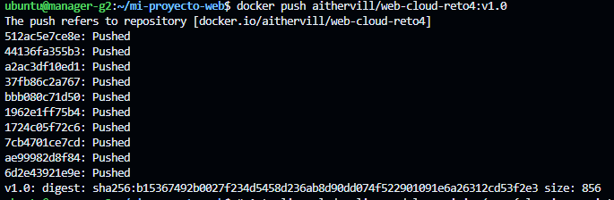

**Figura 16. Subida de la imagen v1.0 a Docker Hub.** *Prueba: ejecutar docker push aithervill/web-cloud-reto4:v1.0. Resultado: todas las capas se suben («Pushed») y se obtiene el digest de la imagen. Autor: Aitor Hernández Asir.*

## 6.3. Despliegue del servicio

El servicio mi-aplicacion-web se despliega con 4 réplicas, conectado a la red red-g2 y publicando el puerto 80.

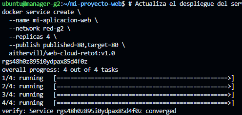

**Figura 17. Creación del servicio con 4 réplicas.** *Prueba: ejecutar docker service create con --replicas 4 y --network red-g2. Resultado: las 4 tareas pasan a «running» y el servicio converge. Autor: Aitor Hernández Asir.*

## 6.4. Validación desde las IP públicas

Gracias al routing mesh de Swarm, la web carga desde la IP pública de cualquiera de los nodos.

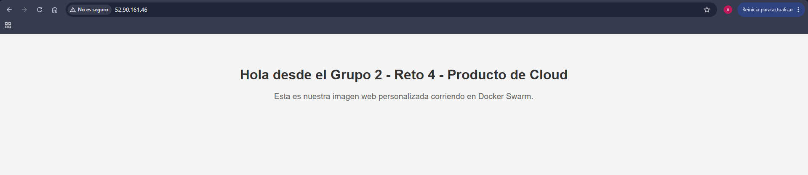

**Figura 18. Web v1.0 desde la IP pública del manager.** *Prueba: acceder a http://52.90.161.46. Resultado: se muestra «Hola desde el Grupo 2 - Reto 4 - Producto de Cloud». Autor: Aitor Hernández Asir.*

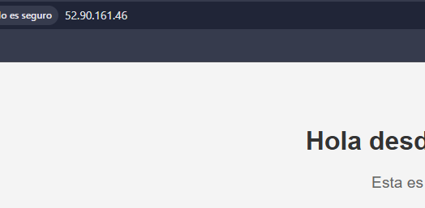

**Figura 19. Detalle de la web v1.0 en el manager.** *Prueba: ampliar la captura anterior. Resultado: contenido de la página legible. Autor: Aitor Hernández Asir.*

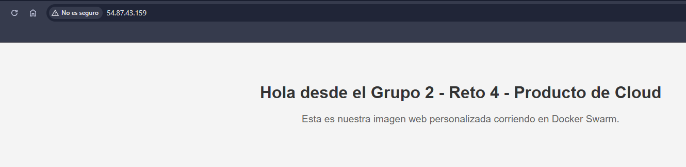

**Figura 20. Web v1.0 desde la IP pública de worker3.** *Prueba: acceder a http://54.87.43.159. Resultado: la misma página se sirve desde un worker. Autor: Aitor Hernández Asir.*

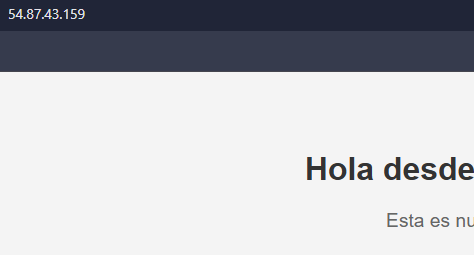

**Figura 21. Detalle de la web v1.0 en worker3.** *Prueba: ampliar la captura anterior. Resultado: contenido de la página legible. Autor: Aitor Hernández Asir.*

## 6.5. Imagen versión 2.0

Se actualiza el HTML con el nuevo diseño («Docker Swarm en AWS»), se construye la imagen v2.0 y se sube a Docker Hub, donde quedan disponibles las versiones 1.0 y 2.0.

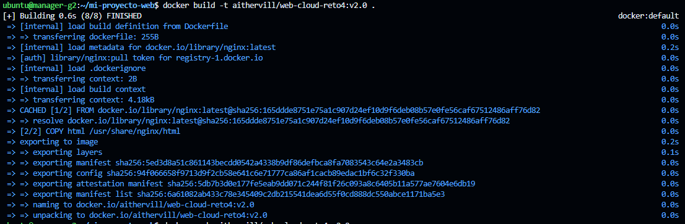

**Figura 22. Construcción de la imagen v2.0.** *Prueba: ejecutar docker build -t aithervill/web-cloud-reto4:v2.0. Resultado: la compilación finaliza correctamente aprovechando capas en caché. Autor: Aitor Hernández Asir.*

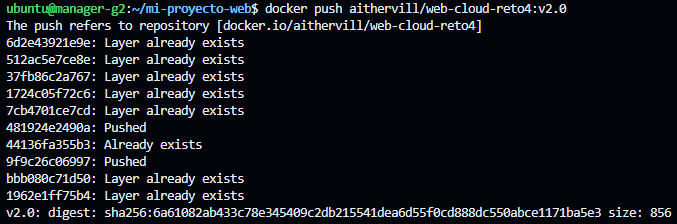

**Figura 23. Subida de la imagen v2.0 a Docker Hub.** *Prueba: ejecutar docker push de la v2.0. Resultado: solo se suben las capas nuevas; el resto ya existían. Autor: Aitor Hernández Asir.*

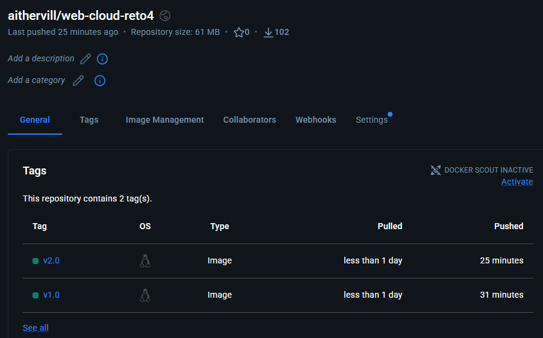

**Figura 24. Repositorio en Docker Hub.** *Prueba: comprobar las versiones publicadas. Resultado: el repositorio aithervill/web-cloud-reto4 contiene las etiquetas v1.0 y v2.0. Autor: Aitor Hernández Asir.*

## 6.6. Actualización del servicio a v2.0

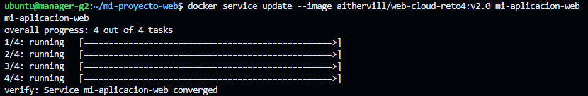

**Figura 25. Actualización del servicio a la imagen v2.0.** *Prueba: ejecutar docker service update --image ...:v2.0. Resultado: las 4 tareas se actualizan y el servicio converge. Autor: Aitor Hernández Asir.*

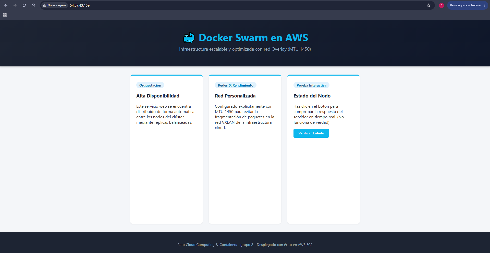

**Figura 26. Web v2.0 desde la IP pública de worker3.** *Prueba: acceder a http://54.87.43.159. Resultado: se muestra la página «Docker Swarm en AWS». Autor: Aitor Hernández Asir.*

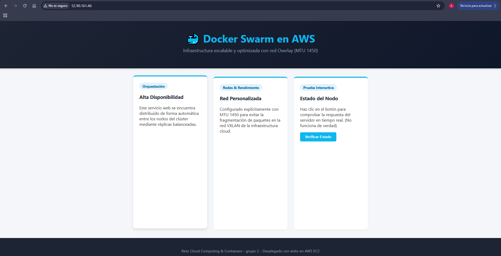

**Figura 27. Web v2.0 desde la IP pública del manager.** *Prueba: acceder a http://52.90.161.46. Resultado: se muestra la misma página v2.0. Autor: Aitor Hernández Asir.*

# 7. Fase 5: Pruebas de orquestación

Todas las pruebas se realizan mientras un script consulta la web de los cuatro nodos de forma continua, de modo que se pueda comprobar si el servicio sufre cortes. En los terminales se muestra el prompt con el hostname y la hora.

## 7.1. Herramientas de prueba

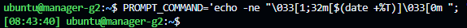

**Figura 28. Prompt con hora.** *Prueba: configurar PROMPT_COMMAND para mostrar la hora en el prompt. Resultado: el prompt muestra \[hh:mm:ss\] ubuntu@manager-g2. Autor: Aitor Hernández Asir.*

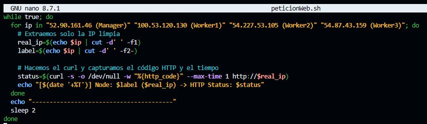

**Figura 29. Script peticionWeb.sh.** *Prueba: consultar con curl la web de manager y workers en bucle. Resultado: muestra el código HTTP de cada nodo (con timeout de 1 s) y repite el ciclo cada 2 s. Autor: Aitor Hernández Asir.*

Nota: la guía pide una consulta cada segundo; el script usa una pausa de 2 s entre rondas.

## 7.2. Balanceo y escala

Se escala el servicio a 8 réplicas y después se baja a 2. El servicio no se cae en ningún nodo durante el proceso.

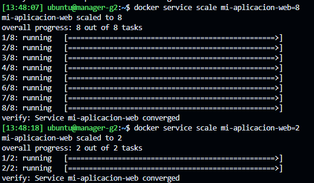

**Figura 30. Escalado del servicio a 8 y 2 réplicas.** *Prueba: ejecutar docker service scale mi-aplicacion-web=8 y después =2. Resultado: ambos escalados convergen correctamente. Autor: Aitor Hernández Asir.*

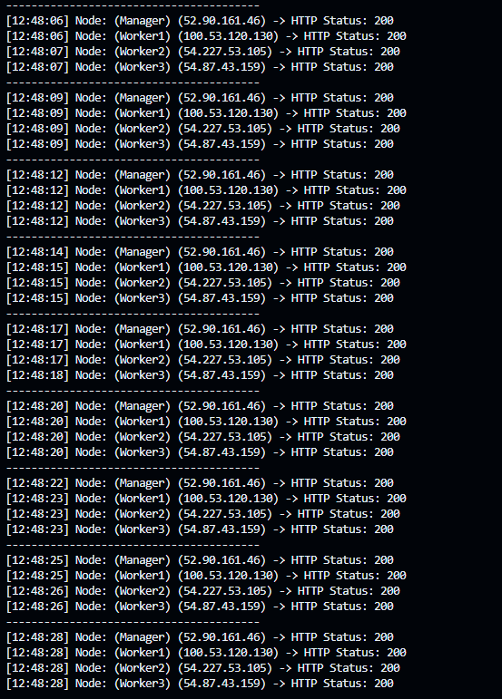

**Figura 31. Respuesta de los 4 nodos durante el escalado.** *Prueba: observar el script de consulta mientras se escala. Resultado: todos los nodos devuelven HTTP 200 sin interrupciones. Autor: Aitor Hernández Asir.*

## 7.3. Autorreparación

Se parte de las 4 réplicas en ejecución, se elimina manualmente un contenedor en worker1 y Swarm crea uno nuevo automáticamente.

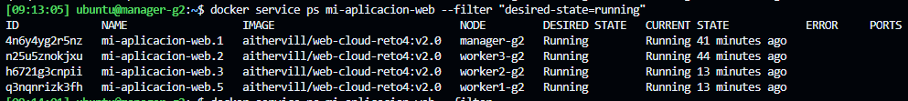

**Figura 32. Réplicas en ejecución antes de la prueba.** *Prueba: listar el servicio filtrando por estado deseado «running». Resultado: 4 réplicas repartidas entre manager, worker1, worker2 y worker3. Autor: Aitor Hernández Asir.*

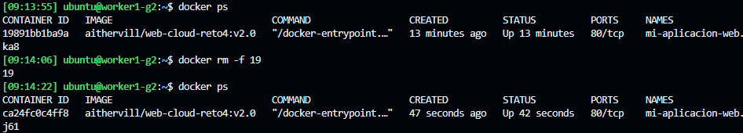

**Figura 33. Borrado del contenedor en worker1.** *Prueba: ejecutar docker rm -f sobre el contenedor de worker1. Resultado: el contenedor se elimina y aparece uno nuevo con pocos segundos de vida. Autor: Aitor Hernández Asir.*

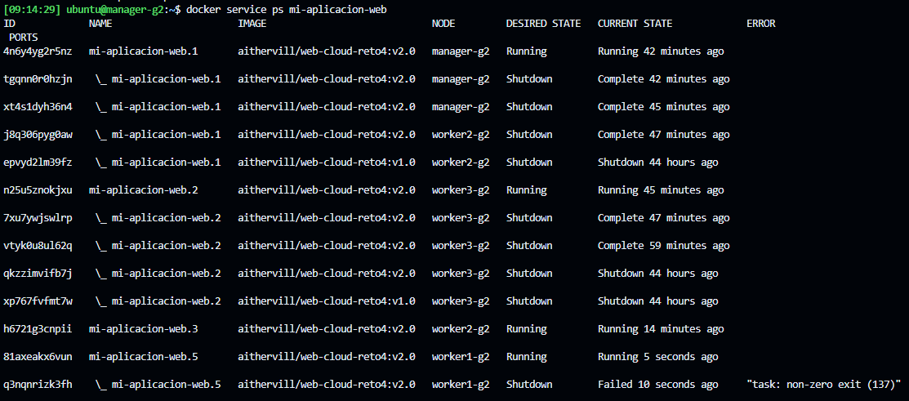

**Figura 34. Historial del servicio tras el borrado.** *Prueba: ejecutar docker service ps mi-aplicacion-web. Resultado: la réplica anterior figura como Failed («non-zero exit (137)») y una nueva réplica lleva 5 segundos en ejecución. Autor: Aitor Hernández Asir.*

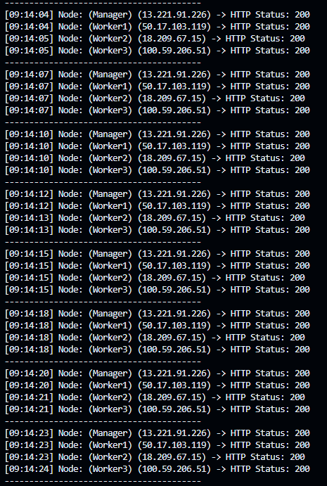

**Figura 35. Respuesta de los nodos durante la autorreparación.** *Prueba: observar el script de consulta. Resultado: todos los nodos responden HTTP 200 sin cortes. Autor: Aitor Hernández Asir.*

## 7.4. Alta disponibilidad

Se parte de 6 réplicas repartidas en los cuatro nodos. A continuación se detiene Docker en worker2 para simular su caída.

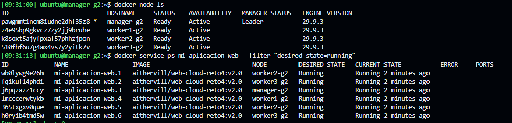

**Figura 36. Estado antes de la caída.** *Prueba: listar nodos y réplicas del servicio (6 réplicas). Resultado: 4 nodos Ready y réplicas repartidas entre ellos. Autor: Aitor Hernández Asir.*

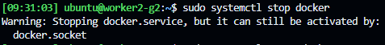

**Figura 37. Parada de Docker en worker2.** *Prueba: ejecutar sudo systemctl stop docker en worker2-g2. Resultado: el servicio Docker se detiene en el nodo. Autor: Aitor Hernández Asir.*

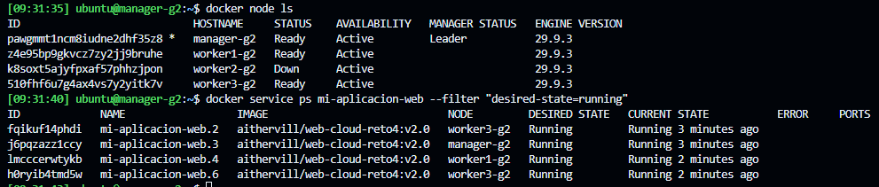

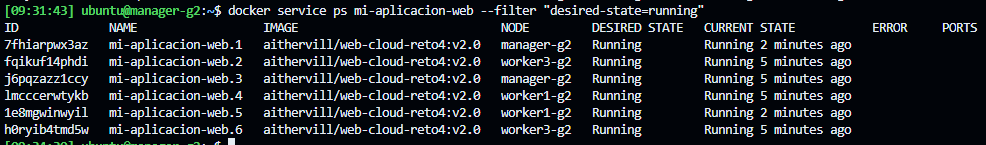

**Figura 38. Réplicas reubicadas tras la caída.** *Prueba: listar nodos y réplicas del servicio. Resultado: worker2 figura como Down y las 6 réplicas se reubican entre los 3 nodos restantes. Autor: Aitor Hernández Asir.*

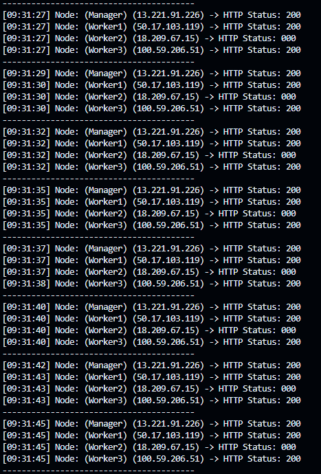

**Figura 39. Respuesta de los nodos con worker2 caído.** *Prueba: observar el script de consulta. Resultado: manager, worker1 y worker3 responden HTTP 200; worker2 devuelve estado 000 porque su servidor Docker está detenido, pero la web sigue disponible en el resto. Autor: Aitor Hernández Asir.*

Una vez reactivado worker2, se fuerza la redistribución de las réplicas entre los 4 nodos con docker service update --force.

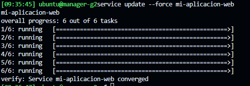

**Figura 40. Redistribución forzada del servicio.** *Prueba: ejecutar docker service update --force mi-aplicacion-web. Resultado: las 6 tareas convergen. Autor: Aitor Hernández Asir.*

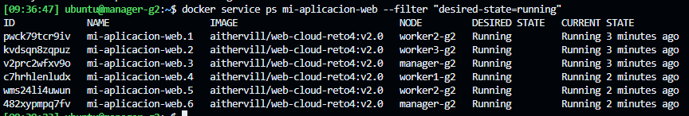

**Figura 41. Réplicas redistribuidas.** *Prueba: listar de nuevo las réplicas. Resultado: vuelven a repartirse entre los nodos activos. Autor: Aitor Hernández Asir.*

## 7.5. Mantenimiento (drain)

Se pone worker1 en modo drain, de forma que sus contenedores se reubican en los demás nodos, y después se reactiva con availability active.

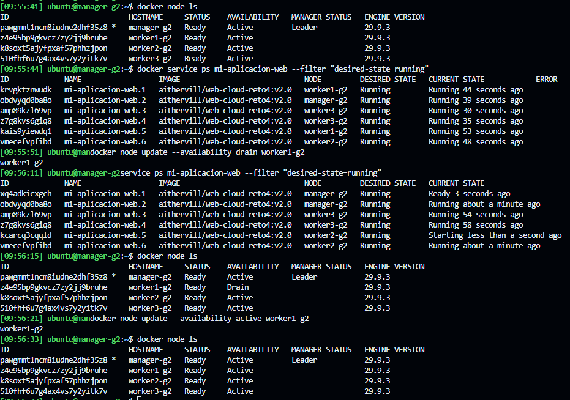

**Figura 42. Nodo en modo drain y reactivación.** *Prueba: ejecutar docker node update --availability drain worker1-g2 y después active. Resultado: worker1 pasa a Drain, las réplicas se reubican en los otros nodos y finalmente el nodo vuelve a Active. Autor: Aitor Hernández Asir.*

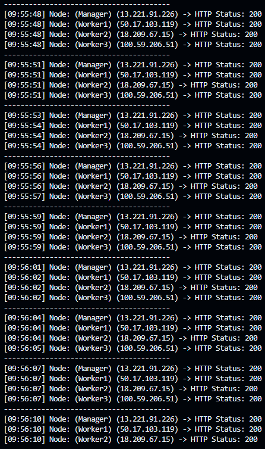

**Figura 43. Respuesta de los nodos durante el mantenimiento.** *Prueba: observar el script de consulta. Resultado: todos los nodos siguen devolviendo HTTP 200. Autor: Aitor Hernández Asir.*

## 7.6. Actualización y rollback

Tras la actualización inicial de v1.0 a v2.0 (apartado 7.6), se prueba el procedimiento inverso: se actualiza el servicio a la v1.0 y después se ejecuta un rollback para volver a la versión anterior (v2.0). Las réplicas se sustituyen de forma progresiva y la web no se cae.

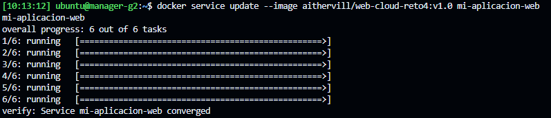

**Figura 44. Actualización del servicio a v1.0.** *Prueba: ejecutar docker service update --image ...:v1.0. Resultado: las 6 tareas se actualizan y el servicio converge. Autor: Aitor Hernández Asir.*

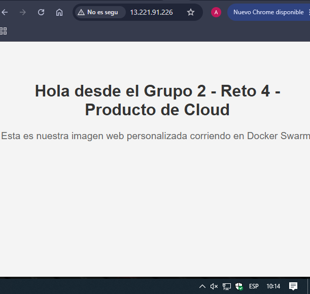

**Figura 45. Web v1.0 tras la actualización.** *Prueba: acceder a la IP pública del manager. Resultado: se muestra «Hola desde el Grupo 2 - Reto 4 - Producto de Cloud». Autor: Aitor Hernández Asir.*

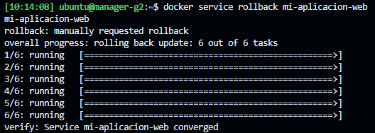

**Figura 46. Rollback del servicio.** *Prueba: ejecutar docker service rollback mi-aplicacion-web. Resultado: el servicio vuelve a la versión anterior y converge. Autor: Aitor Hernández Asir.*

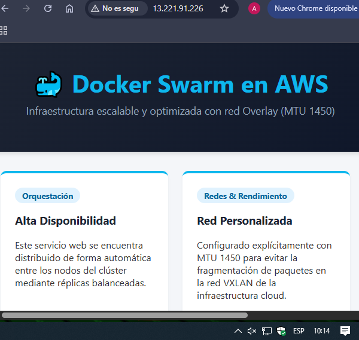

**Figura 47. Web v2.0 tras el rollback.** *Prueba: acceder a la IP pública del manager. Resultado: se muestra de nuevo la página «Docker Swarm en AWS». Autor: Aitor Hernández Asir.*

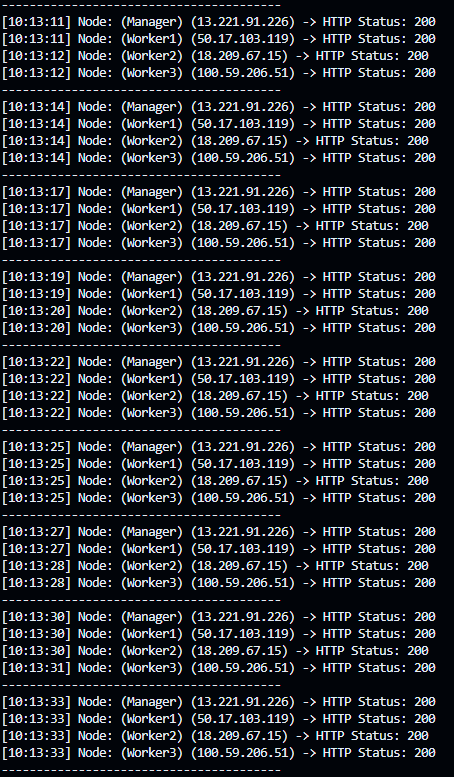

**Figura 48. Respuesta de los nodos durante la actualización.** *Prueba: observar el script de consulta. Resultado: todos los nodos devuelven HTTP 200 sin cortes. Autor: Aitor Hernández Asir.*

## 7.7. Managers

Se promueven worker1 y worker2 a manager. A continuación se detiene Docker en el manager original para simular su caída y se comprueba desde otro nodo que se elige un nuevo líder.

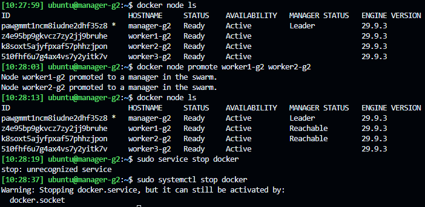

**Figura 49. Promoción de workers y caída del líder.** *Prueba: ejecutar docker node promote worker1-g2 worker2-g2 y detener Docker en manager-g2. Resultado: worker1 y worker2 pasan a ser «Reachable» y se detiene el servicio Docker del manager original. Autor: Aitor Hernández Asir.*

**Figura 50. Nuevo líder elegido.** *Prueba: ejecutar docker node ls desde worker2-g2. Resultado: manager-g2 figura como «Unreachable» y worker1-g2 es el nuevo Leader; el clúster sigue operativo. Autor: Aitor Hernández Asir.*
